# fatfish — Detailed System Design Specification

> **Status**: Draft v1.0 (Post-Audit Baseline)  
> **Language**: Pure Go (`CGO_ENABLED=0`, Go 1.23+)  
> **Repository**: Public Open-Source (strict zero-PII / zero-legacy-coupling hygiene)

---

## 1. Vision, Philosophy & Non-Goals

`fatfish` is a lightweight, self-hosted, multimodal group & personal AI assistant runtime engineered in **Pure Go**. It combines natural group-chat presence (humanlike pacing, native multi-image perception, voice transcription, semantic sticker reactions) with high-leverage agent capabilities (hybrid memory, web/document reading, sandboxed computation & charting, live market quotes, scheduling, and MCP extensibility).

### Core Engineering Principles
1. **Zero-CGO Single Binary**: Compiles with `CGO_ENABLED=0` into one static binary; container image targets **~55–65 MB** and steady-state RSS **60–100 MiB** (including in-memory vector indices and SQLite page caches).
2. **No Black-Box Framework**: No dynamic plugin hooks, no ORM reflection magic, no monolithic LLM wrapper frameworks. Every byte sent to an LLM and every goroutine lifecycle is explicit and auditable.
3. **KV Prefix Cache First**: The prompt layout, tool declarations, canonical image encoding, and segment-pinned memory snapshots are designed from byte 0 to preserve **90%+ KV prefix cache hit rates**.
4. **Dual-Plane Compute Separation**: The Go runtime does orchestration, storage, FTS5, flat `float16` vector scan, Starlark compute, and PNG charting locally; heavy ML inference (Chat, Vision, Embed, Rerank, ASR, optional Translate/OCR/TTS) is cleanly decoupled behind standard OpenAI-compatible HTTP endpoints with per-capability circuit breakers.
5. **Strict Channel Isolation & Defense in Depth**: All history, media, episodes, member profiles, notes, and scheduled jobs are strictly scoped to `channel_id`. Authorization, SSRF protection, and resource quotas are enforced in Go code—never delegated to LLM prompts.
6. **Public-Repo Privacy Hygiene**: Zero hard-coded user IDs, group IDs, LAN IPs, private domains, tokens, or proprietary personas anywhere in the repository; legacy migration scripts live outside this repository and feed `fatfish` solely via its generic JSONL `ingest` format.

### Explicit Non-Goals (v1)
- No legacy bot plugin compatibility layer.
- No multi-node distributed database clustering (single-node SQLite WAL + in-memory `float16` covers up to ~100 active channels / ~100k vectors effortlessly; storage interfaces allow swapping later if needed).
- No heavyweight Node.js/Vite frontend build chain (admin console uses Go `html/template` + embedded HTMX).

---

## 2. System Architecture & Package Dependency DAG

### High-Level Topology

```mermaid
flowchart TB
    CMD["cmd/fatfish\nserve | check | ingest | distill | reindex"]
    APP["internal/app\nWiring, Lifecycle, Hot-Reload, Graceful Shutdown"]

    CON["internal/console\nEmbedded HTMX Admin UI (:6185)"]
    TR["internal/transport/onebot\nOneBot v11 WS Adapter"]
    CRON["internal/cron\nScheduler & Daily Digest"]

    ROOM["internal/room\nPer-Channel Actor\nPerception, Debounce, Gate, Rhythm, Delivery Ledger"]
    POL["internal/policy\nexpr Micro-DSL Rule Engine"]
    FRM["internal/frame\nSegment-Pinned Snapshot, FrozenFrame, KV Guard, Budget Calibrator"]
    AG["internal/agent\nLLM Tool Loop & Text/Media Delivery Split"]

    TOOL["internal/tool\nFrozen Tool Registry, Built-ins, Cached MCP Bridge"]
    MEM["internal/memory\nL0 Timeline, L1 Episodes, L2 Profiles/Lore/Notes"]
    STK["internal/sticker\nDual-Vector, Doc Centering, RRF+Rerank+MMR, Async Send"]

    INF["internal/infer\nOpenAI + Local Inference Clients & Circuit Breakers"]
    ST["internal/store\nDual-Pool SQLite (WAL+FTS5) & SHA-256 BlobStore"]
    VEC["internal/vec\nPure-Go float16 Memory Index"]
    NET["internal/netutil\nPost-DNS SSRF-Safe HTTP Client"]
    MOD["internal/model\nPure Domain Types (Zero External Deps)"]

    CMD --> APP
    APP --> CON & TR & CRON & ROOM
    ROOM --> POL & FRM & AG & STK & MEM
    AG --> INF & TOOL
    TOOL --> MEM & STK & CRON & NET & INF
    MEM --> ST & VEC & INF
    STK --> ST & VEC & INF
    FRM & ROOM & CRON --> ST
    TR & ROOM & FRM & AG & MEM & STK & INF & ST --> MOD
```



### Strict Dependency Rules
- `internal/model` has **zero** dependencies outside the Go standard library.
- `internal/cron` **never** calls `internal/transport` directly; all scheduled triggers are posted into the target `Room` Actor's mailbox as a `SystemTriggerEvent`.
- `internal/transport` **never** performs heavy work (ASR, image resizing, LLM calls) inside the WebSocket reader goroutine; it decodes and enqueues immediately.
- Circular imports are forbidden across all `internal/*` packages.

### Repository Layout

```text
fatfish/
├── cmd/fatfish/main.go             # CLI entrypoint
├── configs/
│   ├── fatfish.example.yaml        # Public example config (placeholders only)
│   └── personas/example.md         # Public example persona
├── docs/
│   ├── SPEC.md                     # This specification (SSOT)
│   └── INGEST_FORMAT.md            # Generic JSONL / sticker directory import format
├── scripts/
│   └── privacy-check.sh            # Pre-commit & CI PII/secret scanner
├── internal/
│   ├── model/                      # Pure domain types
│   ├── config/                     # YAML + ${ENV} expansion + atomic hot-reload
│   ├── netutil/                    # Post-DNS SSRF-safe HTTP client + rate limiter
│   ├── store/                      # Dual-pool SQLite, migrations, CJK FTS5, BlobStore
│   ├── vec/                        # Pure-Go float16 vector index + centering + MMR
│   ├── infer/                      # Chat/Vision, Embed, Rerank, ASR, Translate + circuit breakers
│   ├── transport/
│   │   ├── transport.go            # Platform-agnostic Transport interface
│   │   └── onebot/                 # OneBot v11 WS client, parser, echo tracker
│   ├── policy/                     # expr rule compiler, PolicyEnv, per-channel overrides
│   ├── frame/                      # Segment-pinned memory, FrozenFrame, KV guard, calibrator
│   ├── memory/                     # L0/L1/L2 memory service + resumable offline distiller
│   ├── sticker/                    # Dual-vector retrieval, benchmark eval, async sender, tagger
│   ├── cron/                       # Persistent scheduler & channel daily digest
│   ├── tool/                       # Frozen Registry, MCP cached bridge, built-in tools
│   ├── agent/                      # Turn runner, parallel read-only tools, delivery split
│   ├── room/                       # Per-channel Actor, perception pipeline, rhythm, epoch guard
│   ├── console/                    # Embedded HTMX console (:6185, token auth)
│   └── app/                        # Dependency wiring, signal handling, graceful drain
├── web/                            # Embedded templates + htmx.min.js + minimal CSS
├── assets/fonts/                   # Bundled TrueType (.ttf) CJK font for chart rendering
├── Dockerfile                      # Multi-stage debian-slim + poppler-utils + .ttf font
├── .gitignore
└── go.mod
```

---

## 3. Core Domain Model (`internal/model`)

All platform adapters normalize incoming events into immutable Go structs with strict channel isolation.

```go
type ChannelKind string

const (
	ChannelGroup ChannelKind = "group"
	ChannelDM    ChannelKind = "dm"
)

// ChannelID is canonical: "<platform>:<bot_id>:<kind>:<native_id>"
// e.g. "onebot:100000001:group:123456789"
type ChannelID string

type Member struct {
	ChannelID   ChannelID
	MemberID    string    // Immutable platform user ID (never keyed by nickname)
	DisplayName string    // Latest non-placeholder card/nickname
	Role        string    // "member" | "admin" | "owner" | "bot"
	UpdatedAt   time.Time
}

type PartKind string

const (
	PartText    PartKind = "text"
	PartImage   PartKind = "image"
	PartAudio   PartKind = "audio"
	PartCard    PartKind = "card"
	PartFile    PartKind = "file"
	PartVideo   PartKind = "video"
	PartPoke    PartKind = "poke"
	PartQuote   PartKind = "quote"
	PartForward PartKind = "forward"
)

type Part struct {
	Kind       PartKind `json:"kind"`
	Text       string   `json:"text,omitempty"`
	MediaID    string   `json:"media_id,omitempty"`    // Channel-scoped short ID
	SHA256     string   `json:"sha256,omitempty"`      // Canonical blob digest
	MimeType   string   `json:"mime_type,omitempty"`   // "image/jpeg" | "image/png" | "audio/wav"
	Width      int      `json:"width,omitempty"`
	Height     int      `json:"height,omitempty"`
	DurationMs int      `json:"duration_ms,omitempty"` // Audio / Video duration
	Transcript string   `json:"transcript,omitempty"`  // ASR output for PartAudio
	ASRStatus  string   `json:"asr_status,omitempty"`  // "" | "pending" | "ok" | "failed"
	Title      string   `json:"title,omitempty"`       // Card / File title
	Summary    string   `json:"summary,omitempty"`     // Card desc
	URL        string   `json:"url,omitempty"`         // Card / File URL (SSRF-checked on read)
	FileSize   int64    `json:"file_size,omitempty"`
	RefMsgID   string   `json:"ref_msg_id,omitempty"`  // Quoted platform msg ID
	TargetID   string   `json:"target_id,omitempty"`   // Poke / Mention target
	Nodes      []Part   `json:"nodes,omitempty"`       // Bounded forward nodes (<=20)
}

type Message struct {
	Seq            int64     // Monotonic per-channel sequence assigned on ingress
	ChannelID      ChannelID
	PlatformMsgID  string    // Platform message ID (for replies/quotes/reactions)
	SenderID       string
	SenderName     string    // Card at send time (preserved historically)
	FromBot        bool
	MentionedBot   bool
	RepliedToBot   bool
	PokedBot       bool
	ReplyToMsgID   string
	Parts          []Part
	CreatedAt      time.Time
}
```

### Delivery Ledger (Separating Generation from Delivery)
A model turn produces a `TurnPlan` (text bubbles + optional direct media + optional post-ACK sticker intent + optional poke). Delivery records each step explicitly:
- `planned` → `sending` → `sent` (with `platform_msg_id`) | `partial` | `aborted_epoch` | `aborted_risk` | `failed`.
- **Invariant**: Only `sent` bubbles and `sent` media enter the public channel `Frame` timeline. Uncertain deliveries are never silently retried to avoid duplicate group spam.

---

## 4. Storage, FTS5 & Pure-Go Vector Engine (`internal/store`, `internal/vec`)

### 4.1 Dual-Pool SQLite (`modernc.org/sqlite`)
To eliminate `SQLITE_BUSY` under concurrent actors while capping total SQLite RAM at **≤20 MiB**:

| Pool | MaxOpenConns | Mode | Pragmas | Max Cache RAM |
| :--- | :---: | :--- | :--- | :---: |
| `writeDB` | `1` | `rwc` | `journal_mode=WAL`, `synchronous=NORMAL`, `busy_timeout=5000`, `foreign_keys=ON`, `temp_store=MEMORY`, `cache_size=-8000` | 8 MiB |
| `readDB` | `3` | `ro` | `busy_timeout=5000`, `temp_store=MEMORY`, `cache_size=-4000` | 12 MiB |

- **Maintenance**: Daily low-traffic job executes `PRAGMA wal_checkpoint(TRUNCATE)` and prunes expired `media_assets` / `calibrator_samples`.
- **Graceful Shutdown**: `SIGTERM` executes `PRAGMA wal_checkpoint(PASSIVE)` before closing pools.

### 4.2 Zero-RAM CJK FTS5 Tokenization
SQLite's built-in `unicode61` tokenizer does not split CJK strings into words. Rather than pulling CGO (`gojieba`) or a 30 MB dictionary (`gse`), `store` runs a 30-line pure-Go preprocessor (`TokenizeCJK`) when indexing and querying FTS5:
- Keeps ASCII alphanumerics/identifiers intact (`nvda`, `qwen3`, `192`, `k8s`).
- Emits overlapping CJK bigrams + unigrams for short 1-char terms (`"大肥鱼摸鱼"` → `"大肥 肥鱼 鱼摸 摸鱼"`).
- **Result**: 0 MB extra RAM, handles internet slang, QQ nicknames, stocks, and Chinese-English mixed text with zero dictionary OOV misses.

### 4.3 Core SQLite Schema (DDL Summary)

```sql
-- 1. Channels & epoch state (incremented on /reset to invalidate in-flight turns)
CREATE TABLE channels (
    channel_id        TEXT PRIMARY KEY,
    epoch             INTEGER NOT NULL DEFAULT 1,
    active_segment_id INTEGER NOT NULL DEFAULT 0,
    mute_until        INTEGER NOT NULL DEFAULT 0,
    updated_at        INTEGER NOT NULL
);

-- 2. Immutable member identity + historical alias ledger
CREATE TABLE members (
    channel_id   TEXT NOT NULL,
    member_id    TEXT NOT NULL,
    display_name TEXT NOT NULL,
    role         TEXT NOT NULL DEFAULT 'member',
    last_seen_at INTEGER NOT NULL,
    PRIMARY KEY (channel_id, member_id)
);

CREATE TABLE member_aliases (
    channel_id TEXT NOT NULL,
    member_id  TEXT NOT NULL,
    alias      TEXT NOT NULL,
    first_seen INTEGER NOT NULL,
    last_seen  INTEGER NOT NULL,
    PRIMARY KEY (channel_id, member_id, alias)
);

-- 3. L0 Raw Timeline (all messages including silent/media-only/voice transcripts)
CREATE TABLE messages (
    id              INTEGER PRIMARY KEY AUTOINCREMENT,
    channel_id      TEXT NOT NULL,
    seq             INTEGER NOT NULL,
    platform_msg_id TEXT,
    sender_id       TEXT NOT NULL,
    sender_name     TEXT NOT NULL,
    from_bot        INTEGER NOT NULL DEFAULT 0,
    parts_json      TEXT NOT NULL,
    plain_text      TEXT NOT NULL,     -- Concatenated text + card titles + ASR transcripts
    created_at      INTEGER NOT NULL,  -- Unix milliseconds
    UNIQUE (channel_id, seq)
);
CREATE INDEX idx_messages_chan_ts ON messages(channel_id, created_at DESC);
CREATE INDEX idx_messages_chan_sender ON messages(channel_id, sender_id, created_at DESC);
CREATE INDEX idx_messages_platform_id ON messages(channel_id, platform_msg_id);

CREATE VIRTUAL TABLE messages_fts USING fts5(
    tokens,            -- TokenizeCJK(sender_name + " " + plain_text)
    channel_id UNINDEXED,
    sender_id  UNINDEXED,
    created_at UNINDEXED,
    content='',
    tokenize='unicode61'
);

-- 4. Channel-scoped canonical media registry (blobs live on disk via SHA-256)
CREATE TABLE media_assets (
    channel_id TEXT NOT NULL,
    media_id   TEXT NOT NULL,          -- Short channel-scoped ID e.g. "m_0042"
    sha256     TEXT NOT NULL,
    mime_type  TEXT NOT NULL,
    byte_size  INTEGER NOT NULL,
    width      INTEGER NOT NULL,
    height     INTEGER NOT NULL,
    sender_id  TEXT NOT NULL,
    created_at INTEGER NOT NULL,
    expires_at INTEGER NOT NULL,
    PRIMARY KEY (channel_id, media_id)
);
CREATE INDEX idx_media_expires ON media_assets(expires_at);

-- 5. Context segments & immutable FrozenFrames (KV Prefix Cache storage)
CREATE TABLE segments (
    id              INTEGER PRIMARY KEY AUTOINCREMENT,
    channel_id      TEXT NOT NULL,
    epoch           INTEGER NOT NULL,
    scope_hash      TEXT NOT NULL,     -- SHA256(persona_hash | tools_hash | model_id)
    pinned_snapshot TEXT NOT NULL,     -- Segment-Pinned Memory Snapshot (immutable for segment)
    summary_text    TEXT NOT NULL DEFAULT '',
    created_at      INTEGER NOT NULL,
    last_active_at  INTEGER NOT NULL,
    closed_at       INTEGER NOT NULL DEFAULT 0
);

CREATE TABLE frames (
    id            INTEGER PRIMARY KEY AUTOINCREMENT,
    segment_id    INTEGER NOT NULL REFERENCES segments(id),
    channel_id    TEXT NOT NULL,
    frame_index   INTEGER NOT NULL,
    role          TEXT NOT NULL,       -- 'user' | 'assistant' | 'tool'
    payload_json  TEXT NOT NULL,       -- Canonical serialized OpenAI message (media refs, not base64)
    est_tokens    INTEGER NOT NULL,
    created_at    INTEGER NOT NULL,
    UNIQUE (segment_id, frame_index)
);

-- 6. Delivery Ledger & KV Diagnostics
CREATE TABLE deliveries (
    id           INTEGER PRIMARY KEY AUTOINCREMENT,
    channel_id   TEXT NOT NULL,
    epoch        INTEGER NOT NULL,
    segment_id   INTEGER NOT NULL,
    status       TEXT NOT NULL,        -- planned | sent | partial | aborted_epoch | aborted_risk | failed
    plan_json    TEXT NOT NULL,
    sent_json    TEXT NOT NULL DEFAULT '[]',
    created_at   INTEGER NOT NULL
);

CREATE TABLE kv_metrics (
    id                INTEGER PRIMARY KEY AUTOINCREMENT,
    channel_id        TEXT NOT NULL,
    segment_id        INTEGER NOT NULL,
    model_id          TEXT NOT NULL,
    attempt           INTEGER NOT NULL,
    prompt_tokens     INTEGER NOT NULL,
    cached_tokens     INTEGER NOT NULL,
    completion_tokens INTEGER NOT NULL,
    prefix_hash       TEXT NOT NULL,
    miss_reason       TEXT NOT NULL DEFAULT '',
    latency_ms        INTEGER NOT NULL,
    created_at        INTEGER NOT NULL
);

-- 7. L1 Episodic Memory & L2 Profiles / Lore / Pinned Notes (strictly channel-scoped)
CREATE TABLE episodes (
    id               INTEGER PRIMARY KEY AUTOINCREMENT,
    channel_id       TEXT NOT NULL,
    start_seq        INTEGER NOT NULL,
    end_seq          INTEGER NOT NULL,
    start_ts         INTEGER NOT NULL,
    end_ts           INTEGER NOT NULL,
    topic            TEXT NOT NULL,
    summary          TEXT NOT NULL,
    participants_json TEXT NOT NULL,
    notable_json     TEXT NOT NULL,
    embed_f16        BLOB,             -- 2048 * 2 bytes = 4096 bytes
    created_at       INTEGER NOT NULL
);
CREATE INDEX idx_episodes_chan_ts ON episodes(channel_id, end_ts DESC);

CREATE VIRTUAL TABLE episodes_fts USING fts5(
    tokens, channel_id UNINDEXED, content='', tokenize='unicode61'
);

CREATE TABLE profiles (
    channel_id        TEXT NOT NULL,
    member_id         TEXT NOT NULL,
    facts_json        TEXT NOT NULL,   -- [{text, confidence, evidence_episodes[], updated_at}]
    jokes_json        TEXT NOT NULL,   -- Separated humor/memes so sarcasm never corrupts bio
    updated_at        INTEGER NOT NULL,
    PRIMARY KEY (channel_id, member_id)
);

CREATE TABLE lore (
    id         INTEGER PRIMARY KEY AUTOINCREMENT,
    channel_id TEXT NOT NULL,
    term       TEXT NOT NULL,
    meaning    TEXT NOT NULL,
    confidence REAL NOT NULL DEFAULT 0.5,
    updated_at INTEGER NOT NULL,
    UNIQUE (channel_id, term)
);

CREATE TABLE notes (
    id         INTEGER PRIMARY KEY AUTOINCREMENT,
    channel_id TEXT NOT NULL,
    key        TEXT NOT NULL,
    content    TEXT NOT NULL,
    author_id  TEXT NOT NULL,
    pinned     INTEGER NOT NULL DEFAULT 1,
    created_at INTEGER NOT NULL,
    updated_at INTEGER NOT NULL,
    UNIQUE (channel_id, key)
);

-- 8. Stickers (Dual-Vector + FTS5 + Anti-Spam Decay)
CREATE TABLE stickers (
    sticker_id     TEXT PRIMARY KEY,
    pack_id        TEXT NOT NULL,
    sha256         TEXT NOT NULL UNIQUE,
    rel_path       TEXT NOT NULL,
    status         TEXT NOT NULL DEFAULT 'ready', -- ready | needs_review | disabled
    ocr_text       TEXT NOT NULL DEFAULT '',
    intent_text    TEXT NOT NULL DEFAULT '',      -- emotion, tone, reply scenes
    content_text   TEXT NOT NULL DEFAULT '',      -- visual action, objects, tags
    intent_f16     BLOB,                          -- 2048 * 2B
    content_f16    BLOB,                          -- 2048 * 2B
    created_at     INTEGER NOT NULL
);

CREATE VIRTUAL TABLE stickers_fts USING fts5(
    tokens, pack_id UNINDEXED, content='', tokenize='unicode61'
);

CREATE TABLE sticker_uses (
    channel_id TEXT NOT NULL,
    sticker_id TEXT NOT NULL,
    used_at    INTEGER NOT NULL
);
CREATE INDEX idx_sticker_uses_chan ON sticker_uses(channel_id, used_at DESC);

-- 9. Schedules, Daily Digests, MCP Schema Cache & Budget Calibrator
CREATE TABLE schedules (
    id          INTEGER PRIMARY KEY AUTOINCREMENT,
    channel_id  TEXT NOT NULL,
    creator_id  TEXT NOT NULL,
    kind        TEXT NOT NULL,         -- 'once' | 'cron'
    cron_expr   TEXT NOT NULL DEFAULT '',
    next_run_at INTEGER NOT NULL,
    prompt      TEXT NOT NULL,
    enabled     INTEGER NOT NULL DEFAULT 1,
    created_at  INTEGER NOT NULL
);

CREATE TABLE daily_digests (
    channel_id TEXT NOT NULL,
    day_key    TEXT NOT NULL,          -- YYYY-MM-DD in channel timezone
    report     TEXT NOT NULL,
    stats_json TEXT NOT NULL,
    embed_f16  BLOB,
    created_at INTEGER NOT NULL,
    PRIMARY KEY (channel_id, day_key)
);

CREATE TABLE mcp_tool_cache (
    server_name TEXT PRIMARY KEY,
    tools_json  TEXT NOT NULL,
    updated_at  INTEGER NOT NULL
);

CREATE TABLE calibrator_samples (
    id          INTEGER PRIMARY KEY AUTOINCREMENT,
    model_key   TEXT NOT NULL,         -- provider|endpoint|model
    est_text    INTEGER NOT NULL,
    actual_tok  INTEGER NOT NULL,
    image_count INTEGER NOT NULL,
    created_at  INTEGER NOT NULL
);
```

### 4.4 Canonical BlobStore (`internal/store/blob.go`)
- Original images are **never** stored inside SQLite.
- On ingest (`Perception`), images are validated (≤10 MiB), decoded (`image/jpeg`, `image/png`, `image/gif`, `x/image/webp`), resized to canonical max dimension (e.g. `1280px` longest edge), and deterministically encoded **once** as **JPEG (quality 85)** (or **PNG** if image has alpha transparency; animated GIF takes first representative frame for LLM while preserving raw file for `send_media`!).
- Stored at `<data_dir>/blobs/<sha256[0:2]>/<sha256>.<ext>`.
- Enforces soft per-channel quota (`256 MiB`) and hard global quota (`1024 MiB`) via LRU expiry sweep.

### 4.5 Pure-Go `float16` Memory Vector Engine (`internal/vec`)
- Backed by a single flat `[]uint16` slice (`github.com/x448/float16`) for cache-friendly sequential scanning:
  - 3,170 stickers × 2 vectors × 2,048d × 2B = **~26 MiB** (or ~13 MiB single-vector).
  - 5,000 L1 episodes × 2,048d × 2B = **~20 MiB** (lazy-loaded per active channel or resident).
- Pure Go dot product on 3,170 × 2,048 `float16` completes in **~1–3 ms** with zero CGO and zero FAISS.
- **Document-Only Tunable Mean-Centering**:
  - Offline/on-reindex computes corpus mean $\mu_{\text{doc}}$.
  - Stored vectors are pre-normalized as $d'_i = \text{norm}(d_i - \alpha \cdot \mu_{\text{doc}})$ ($\alpha \in [0, 1]$, empirically tuned via `sticker_eval`, default `0.7` for homogeneous sticker packs, `0.0` for diverse episodes).
  - Query vector $q$ is strictly L2-normalized **without** subtracting $\mu_{\text{doc}}$ (preventing opposite-direction query shift!).
- **Interface Abstraction**: `type Index interface { Upsert(...); Delete(...); Search(q []float32, k int, filter func(id string) bool) []Hit }` — trivially swappable to pure-Go HNSW if corpus ever exceeds 100k items.

---

## 5. Per-Channel Actor, Perception & Policy (`internal/room`, `internal/policy`)

### 5.1 Ingress & Non-Blocking Perception Pipeline
1. `transport/onebot` WS reader decodes inbound JSON and pushes to `RoomManager.Dispatch(event)` (non-blocking buffered channel `cap=256`).
2. Target `Room` Actor assigns monotonic `seq`, updates `members` & `member_aliases` (ignoring numeric placeholder names), and launches bounded async perception tasks for attachments in the message:
   - **Images**: download via `netutil` (or NapCat local/API), canonicalize into `BlobStore`, register `media_id` scoped to `channel_id`.
   - **Audio (`PartAudio`)**: call `transport.FetchAudio(file, "wav")` (NapCat `get_record` transcodes SILK v3 → WAV) → call `infer.Transcribe(ctx, wav)` (`POST /v1/audio/transcriptions` multipart) → fill `Part.Transcript`.
   - **QQ JSON Cards**: parse `app`/`meta` into `PartCard{Title, Summary, URL}`.
   - **Quotes / Forwards**: bounded resolution (quote depth ≤3, forward nodes ≤20).
3. **Bounded Per-Turn Wait**: If the message triggers or joins an active turn, the Actor waits up to `media_wait=3s` (or `asr_wait=4s` for voice) so the canonical image / transcript arrives inline in the turn without blocking other channels. If ASR times out, the turn proceeds with `[语音 Xs，转写中]` and the background task patches L0 + FTS5 upon completion.

### 5.2 Deterministic `expr` Policy Engine (`internal/policy`)
All volatile behavioral rules live in YAML and compile via `github.com/expr-lang/expr` against a strongly-typed `PolicyEnv` struct:

```go
type PolicyEnv struct {
	IsGroup       bool    `expr:"is_group"`
	FromBot       bool    `expr:"from_bot"`
	IsAdmin       bool    `expr:"is_admin"`
	Mentioned     bool    `expr:"mentioned"`
	RepliedToBot  bool    `expr:"replied_to_bot"`
	Poked         bool    `expr:"poked"`
	HitNickname   bool    `expr:"hit_nickname"`
	InThread      bool    `expr:"in_thread"`
	ThreadTurns   int     `expr:"thread_turns"`
	CooldownOK    bool    `expr:"cooldown_ok"`
	IsNight       bool    `expr:"is_night"`
	Hour          int     `expr:"hour"`
	BurstUsers    int     `expr:"burst_users"`
	NewMsgs       int     `expr:"new_msgs"`
	WaitSec       float64 `expr:"wait_sec"`
	Proactive     bool    `expr:"proactive"`
	TextLen       int     `expr:"text_len"`
	ImageKB       int     `expr:"image_kb"`
	Rand          float64 `expr:"rand"` // Pre-sampled [0,1) for deterministic unit tests!
}
```

- **Safe Hot-Reload**: On `fsnotify` change or Console save: parse YAML → compile EVERY `expr` rule with `expr.Env(PolicyEnv{})` + `expr.AsBool()` → only if 100% pass, atomically swap `atomic.Pointer[Config]`. Invalid edits are rejected cleanly with line-level diagnostics while keeping live service untouched.
- **Per-Channel Overrides**: `policy.overrides["group:123456789"]` inherits base rules and overrides specific fields/expressions.

### 5.3 Humanlike Interaction Pipeline (Built-in Room Mechanics)
- **Trigger & Debounce**: Explicit `@` / reply / poke wakes immediately; pure `@` waits `1.0s` for follow-up message from same sender; burst messages from same sender coalesce over `input_debounce_seconds`.
- **Proactive Funnel**: Policy `reply_gate` → `ignored_bot_ids` check → hard cooldown → fast-model JSON Gate (`gate_token_budget=4096`, `include_images=false`, outputs `reply | react:<emoji> | ignore`) → **Stale-Drop Guard** (`drop_stale` evaluated right before generation & right before delivery so late replies are dropped if group moved on!).
- **Thread Continuation**: After replying, same member can continue without `@` within `thread_continuation_seconds` (max `3` turns, min interval `4s`).
- **Zero-Latency `+1` Repeater**: When `>=3` distinct members send identical short phrase, probabilistically echo (`0.32`) or let LLM playfully break chain (`0.06`), with `180s` cooldown.
- **Natural Output Formatting**:
  - `smart_reply_decoration`: omit quote/`@` when replying directly below target; quote-only when displaced; never attach fake quote on poke.
  - Short-bubble split: split prose newlines into `<=4` short bubbles (skipping fenced code blocks and structured tables), bubble 1 sent at `0ms`, bubbles 2..4 delayed `0.3–1.0s` proportional to length.
  - `strip_trailing_period`: remove isolated trailing `。` on casual utterances `<=25` chars.
- **Epoch & Risk Guard**:
  - Every `TurnPlan` captures `channel.epoch`. `/reset` increments `epoch` immediately, cancelling any queued bubbles or pending async sticker sends.
  - On QQ mute/risk error (`retcode=1200`), abort remaining bubbles, cancel async sticker, set `mute_until = now + mute_backoff_seconds (1800s)`.

---

## 6. Frame Builder & KV Prefix Cache Invariants (`internal/frame`)

### 6.1 Exact Prompt Layout (Byte-Identical Prefix Guarantee)

```text
[tools]      Sorted, flattened OpenAI Function Schemas (<=12 tools; MCP cached manifest)
             --> 100% BYTE-IDENTICAL across entire segment

[msg 0]      role: "system"
             Immutable Persona Markdown + Core Behavior Contract
             --> 100% BYTE-IDENTICAL across all turns & segments

[msg 1]      role: "user" (or system-context block)
             Segment-Pinned Memory Snapshot (frozen ONCE at segment creation):
               - Group Lore (<=120 tok)
               - Pinned Notes (<=140 tok)
               - Recent Segment Summary (if rotated, <=250 tok)
               - Active Member Cards (<=220 tok, strictly separate budget from facts/notes!)
             --> 100% BYTE-IDENTICAL for the entire 30-min segment!

[msg 2..k]   FrozenFrames (append-only user / assistant / tool messages)
             - Canonical base64 images generated deterministically from SHA-256 blobs
             - New mid-segment member cards appear ONCE as a compact line in that turn
             --> 100% BYTE-IDENTICAL once frozen!

[msg k+1]    Current Active Turn (new messages since last turn, with [HH:MM] Name(id): ...)
             --> ONLY part that grows per turn!
```

### 6.2 Segment Lifecycle & Budget Calibration
- **Scope Key**: `scope_hash = SHA256(persona_hash | tools_hash | model_id)`. Any intentional change cleanly opens a new segment.
- **Idle Rotation**: After `segment_idle_minutes` (default `30m`), close segment → asynchronously generate L1 Episode & rotated summary (with fast model) → next turn opens a fresh segment with updated `Segment-Pinned Memory Snapshot`.
- **Batch Trim (80% → 50%)**: When estimated tokens reach `80%` of `input_token_budget` (default `32768`), drop oldest complete turns (user + tool + assistant together) down to `~50%` so prefix cache stabilizes again across the next 10–15 turns rather than sliding-window invalidating on every single turn!
- **Adaptive Token Budget Calibrator**: Rolling window of last `96` first-attempt actual `prompt_tokens` per `provider|endpoint|model`. Adjusts text token multiplier with `+20%` safety margin (never modifies prompt/frames; image reserve only adjusts upward).
- **Mandatory CI Guard (`TestKVCacheInvariants`)**: Simulates 10 multi-turn interactions with images, tool calls, new members, and simulated MCP outage; asserts `tools` JSON bytes, `msg[0]` bytes, `msg[1]` bytes, and all `FrozenFrame[0..i-1]` bytes remain **100% bit-for-bit identical**.

---

## 7. Inference Plane & Circuit Breakers (`internal/infer`)

Thin, zero-SDK stdlib `net/http` clients giving full control over wire JSON, timeouts, and headers:

| Capability | Protocol | Key Guarantees | Degradation When Unavailable |
| :--- | :--- | :--- | :--- |
| **`Chat` / `Vision`** | OpenAI `POST /v1/chat/completions` | Preserves raw `cached_tokens`, `reasoning_content`; **never** silently strips images on error; independent request client | Return concise failure log; never corrupt timeline |
| **`Embed`** | OpenAI `POST /v1/embeddings` | Enforces hard `max_batch` chunking (`1..128`, default `64`) at client boundary | Circuit opens → `recall` & `sticker` fall back to SQLite FTS5 |
| **`Rerank`** | `POST /v1/rerank` (JSON) | Enforces `max_batch` cap (`1..128`, default `64`); returns normalized scores | Circuit opens → keep RRF ranking order directly |
| **`ASR`** | OpenAI `POST /v1/audio/transcriptions` (multipart) | Sends `file` (`wav`) + `model`; bounded per-turn wait (`4s`) | Circuit opens → store `[语音 Xs，暂不可转写]` |
| **`Translate`** *(internal)* | OpenAI `POST /v1/chat/completions` | Used internally by `read_source` for long foreign docs or explicit `/tr` command (NOT a primary LLM tool) | Falls back to primary LLM |

### Local Inference GPU Protection (Preventing VRAM Thrashing)
- **Hot vs Cold Separation**: Online hot traffic uses only compact resident models (`embed`, `rerank`, `asr`). Heavy local models (`distill`) are strictly isolated to offline CLI (`fatfish distill`) or configurable off-peak windows behind a concurrency semaphore (`max_concurrent_heavy=1`).
- **Circuit Breaker**: Per-capability sliding window (`3` consecutive failures → Open for `30s` → Half-Open single probe). Exposes live state on `:6185` console.

---

## 8. Three-Tier Memory & Offline Distillation (`internal/memory`)

### Tier Structure (Strictly Channel-Scoped)
- **L0 — Raw Timeline + FTS5**: Every message (including voice transcripts, card titles, bot replies) persisted with immutable `sender_id` and historical `sender_name`. Exact keyword/alias/date lookup via `recall(mode="raw")`.
- **L1 — Episodic Memory (`episodes`)**:
  - **Windowing Algorithm**: Partition channel timeline into conversational episodes separated by `>15 min` silence or `>100` valid messages (filtering pure single-emoji/spam noise).
  - **Structured Extraction** (JSON output): `{topic, summary, participants: [{id, role_in_topic}], notable_quotes, candidate_facts, candidate_jokes, candidate_lore}`.
  - Embedded into 2048d `float16` vectors + indexed in `episodes_fts`.
  - Created both **offline** (`fatfish distill --concurrency 2 --limit N`, resumable via checkpoint) and **online** (automatically on NativeMM 30-min segment close!).
- **L2 — Profiles, Lore & Explicit Pinned Notes**:
  - **Anti-Sarcasm Corroboration**: `candidate_facts` extracted from a single episode stay `tentative`; only facts corroborated across `>=2` distinct episodes (or explicitly stated seriously) promote to `profiles.facts_json` with confidence & time decay. Jokes/shitposting route exclusively to `profiles.jokes_json` or `lore`.
  - **Explicit Notes (`notes`)**: Created/updated/deleted via `note` tool; `pinned=1` facts never decay and always appear inside the `Segment-Pinned Memory Snapshot`.

---

## 9. Dual-Vector Sticker Engine (`internal/sticker`)

Designed specifically to solve homogeneous-IP ("all stickers share one character") vector collapse and repetitive sticker spam:

1. **Dual-Vector Representation**:
   - `v_intent` (`float16`, 2048d): encodes `{emotion, tone, reply_intent, suitable_scenes}`.
   - `v_content` (`float16`, 2048d): encodes `{ocr_text, action, visual_elements, tags}`.
   - Dynamic blend weights:
     - Conversational reaction: `0.75 * v_intent + 0.25 * v_content`
     - Explicit image lookup: `0.25 * v_intent + 0.75 * v_content`
2. **Document-Only Tunable Mean-Centering**:
   - Pre-center stored vectors $d'_i = \text{norm}(d_i - \alpha \mu_{\text{doc}})$; leave query $q$ unshifted.
   - Ships with `fatfish reindex --eval eval_queries.yaml` harness to empirically measure Recall@5 & diversity across $\alpha \in \{0.0, 0.5, 0.7, 1.0\}$.
3. **3-Way Hybrid Recall → RRF → Rerank → MMR**:
   - Recall: `stickers_fts` Top-20 (exact OCR/tag hits) + `v_intent` Top-30 + `v_content` Top-30 → Reciprocal Rank Fusion Top-25.
   - Precision Rerank: `infer.Rerank` using `"<last user msg> -> <bot reply>"` as contextual query (gracefully skipped if rerank circuit is open).
   - Anti-Repeat & Diversity: Exponential decay penalty for stickers used in the same `channel_id` within the last `30` sends + MMR diversity across Top-5 + low-temperature sampling.
4. **Zero-Latency Post-ACK Async Delivery**:
   - For casual chat reactions, the LLM optionally emits a compact trailing marker (e.g. `[[sticker: 无语摊手]]`) which `agent` strips before sending text (`0ms` delay, **0 extra LLM round-trip**!).
   - Once text bubble ACK succeeds, a bounded background worker (`max=32`, timeout `15s`) selects and sends the sticker if `channel.epoch` has not changed, recording it into the public media timeline.
   - Explicit `send_sticker` tool remains available when a user specifically asks for a sticker.

---

## 10. High-Leverage Tool Layer & MCP Bridge (`internal/tool`, `internal/agent`)

### 10.1 Tool Interface & Frozen Registry

```go
type ToolResult struct {
	TextForLLM  string        // Digested silently by primary LLM into natural chat tone
	DirectMedia []DirectMedia // Optional PNG chart / image sent directly to channel
	SideEffect  string        // Optional audit summary
}

type Tool[Args any] interface {
	Name() string
	Description() string
	ReadOnly() bool // ReadOnly tools in one turn may execute concurrently via errgroup
	Execute(ctx context.Context, tc ToolContext, args Args) (ToolResult, error)
}
```

- **Flattened JSON Schema**: `invopop/jsonschema.Reflector{DoNotReference: true, ExpandedStruct: true}` with `$schema`/`$id` stripped; CI asserts **zero `$ref`/`$defs`** for 100% OpenAI-compatible provider safety.
- **Fixed Tool Order**: Registry sorts tools lexicographically at boot and freezes the serialized OpenAI `tools` payload.
- **Cached MCP Manifest**: Uses `github.com/modelcontextprotocol/go-sdk` (Streamable HTTP & stdio). Discovered MCP tool definitions are persisted in `mcp_tool_cache`. On startup/reconnect failure, cached definitions remain declared so `tools` never flaps and KV cache stays intact; calls return a graceful temporary-unavailable error.

### 10.2 Complete Built-in Tool Specification (10 Built-ins + MCP)

| Tool | ReadOnly | Key Design & Hardening Details |
| :--- | :---: | :--- |
| **`recall`** | Yes | Modes: `recent`, `raw` (FTS5 + old-alias resolution + sender/date filter), `memory` (L1 Episodes + L2 Profiles/Lore + Daily Digests via FTS5+Vector+Rerank). Strictly scoped to `tc.ChannelID`. |
| **`note`** | No | Actions: `save(key, content, pinned)`, `list`, `delete(key)`. Exact channel-scoped facts/lists; server enforces max 50 notes/channel. |
| **`web_search`** | Yes | Uncensored fallback search (`bing`, `baidu`, `github`, `hf_mirror`, `arxiv`) via `netutil` + `goquery`. Used when primary MCP search is filtered or unavailable. |
| **`read_source`** | Yes | Deep reader for: `bilibili` (`b23.tv` expand, meta, pages, subtitles, top comments), `arxiv` (Atom + PDF pages), `hf` (`hf-mirror.com` API + README), generic URLs, and QQ `file` URLs (`.xlsx` via `excelize`, `.docx` via stdlib `zip+xml`, `.pdf` via `pdftotext`, plain text). **Hardened**: `safehttp` post-DNS SSRF Dialer, `10 MiB` cap, untrusted-content framing, optional internal `translate` via `infer.Translate` for long foreign docs. |
| **`compute`** | Yes | Pure-Go `go.starlark.net` sandbox + optional PNG chart output. Preloads `math`, `json`, `time`, plus Go-native `stats` (`mean/median/stdev/percentile/corr/linreg`), `finance` (`pmt/irr/npv/cagr/drawdown`), and `chart` (`line/bar/pie/scatter/kline` rendered via `go-charts`/`gg` + bundled **TrueType `.ttf`** CJK font). **Hardened**: 40-line `syntax` AST pre-validator blocking giant list/string multiplication & huge ranges (prevents OOM DoS) + `SetMaxExecutionSteps(500_000)` + `3s` wall timeout + `64 KiB` output cap. |
| **`quote`** | Yes | Direct Tencent realtime quote + 60-day daily K-line for US (`usNVDA`), HK (`hk00700`), and A-share (`sh600519`/`sz000001`), decoded cleanly via `golang.org/x/text` (GBK). |
| **`schedule`** | No | Actions: `create(once/cron, prompt)`, `list`, `cancel(id)`. Enforces `(channel_id, creator_id)` ownership, max `10` active jobs/channel, min cron interval `>=5m`. Fires by posting `SystemTriggerEvent` to target `Room` Actor. |
| **`send_sticker`** | No | Explicit sticker search & delivery (dual-vector + FTS5 + Rerank + MMR). |
| **`send_media`** | No | Re-sends a visible image from current channel by short `media_id`. Enforces `(channel_id, media_id)` ownership at DB layer. |
| **`interact`** | No | Actions: `poke` (current sender, `2s` timeout, max once/turn), `react` (emoji like on trigger msg), `relay` (send to another channel — **disabled by default for non-admins**, explicit channel allowlist enforced server-side). |
| **`mcp.*`** | per-spec | External MCP servers (e.g., web search, web reader, repo reader, future tools), strictly namespaced & timeout-bounded. |

---

## 11. Console, CLI, Config & Operations

### 11.1 CLI (`cmd/fatfish`)
- `fatfish serve -c fatfish.yaml` — Run transport, rooms, scheduler, and `:6185` console.
- `fatfish check -c fatfish.yaml` — Validate YAML, compile all `expr` rules, verify bundled `.ttf` font & `pdftotext`, probe transport, inference endpoints, and MCP servers.
- `fatfish ingest --messages <file.jsonl> [--stickers <dir>]` — Generic platform-agnostic importer (zero coupling to any legacy bot).
- `fatfish distill -c fatfish.yaml [--channel <id>] [--limit 20] [--concurrency 2]` — Resumable offline L0 → L1/L2 memory distillation.
- `fatfish reindex -c fatfish.yaml [--eval queries.yaml]` — Rebuild dual-vector `float16` indices, corpus centering vectors, and FTS5 tables.

### 11.2 Embedded Admin Console (`internal/console`, `:6185`)
- **Zero-build frontend**: Go 1.23 `net/http` ServeMux + `embed.FS` + `html/template` + vendored `htmx.min.js` (~14 KB).
- **Security**: Binds `127.0.0.1:6185` by default; mandatory Bearer/Cookie token (`${FATFISH_CONSOLE_TOKEN}`, auto-generated random 32-byte hex on first boot if unset), constant-time verification (`crypto/subtle`), `SameSite=Strict; HttpOnly` session cookie.
- **Views**:
  1. Dashboard (RSS memory, active rooms, circuit breaker states, live KV Prefix Cache hit-rate chart, tool latency/error breakdown).
  2. Persona & Config Editor (live YAML + `expr` dry-run validator before save).
  3. Memory Explorer (browse L1 Episodes, L2 Profiles/Lore, edit Pinned Notes per channel).
  4. Sticker Manager (search test with dual-vector score breakdown, `needs_review` approval queue).
  5. Live Structured Log Stream (`slog` JSON ring buffer via SSE).

### 11.3 Graceful Shutdown (`SIGTERM` / `SIGINT`)
1. Mark service draining and close inbound transport reception.
2. Wait up to `15s` for in-flight LLM turns, bubble deliveries, and pending async sticker tasks to finish.
3. Stop scheduler, close MCP connections, flush `PRAGMA wal_checkpoint(PASSIVE)`, close `readDB` and `writeDB`.

### 11.4 Container Packaging (`Dockerfile`)
- Stage 1: `golang:1.24-bookworm`, `CGO_ENABLED=0 go build -trimpath -ldflags="-s -w" ./cmd/fatfish`
- Stage 2: `debian:bookworm-slim` + `ca-certificates` + `poppler-utils` (`pdftotext`) + bundled `.ttf` CJK font (`assets/fonts/`).
- Target image size: **~55–65 MB**; runtime RSS target: **60–100 MiB**.

---

## 12. Security, Privacy & Phased Delivery Plan

### Security & Privacy Checklist
- **Post-DNS SSRF Protection (`internal/netutil`)**: Custom `net.Dialer.Control` inspects resolved IP addresses before TCP `connect()`, blocking `127.0.0.0/8`, `10.0.0.0/8`, `172.16.0.0/12`, `192.168.0.0/16`, `169.254.0.0/16`, `100.64.0.0/10`, `::1`, `fc00::/7`, `fe80::/10` unless explicitly matched by `netutil.allow_hosts` (for configured local inference endpoints only).
- **Untrusted Content Framing**: All external web/document/file/card contents returned to the LLM are wrapped in `<external_data source="...">...</external_data>` boundaries; authorization checks never trust LLM parameters alone.
- **Public Repo Privacy Gate (`scripts/privacy-check.sh`)**: Runs locally and in GitHub Actions to reject commits containing private LAN IPs, real secret prefixes (`sk-`, `ghp_`, `Bearer `), private hostnames, or unmasked personal IDs.

### Delivery Milestones & Verification Matrix

| Milestone | Scope | Exit Criteria (Tests & Live Verification) |
| :--- | :--- | :--- |
| **M1 — Core Runtime** | `model`, `config`, `netutil`, `store` (dual-pool + CJK FTS5 + BlobStore), `policy` (`expr`), `infer` (OpenAI + ASR + Embed/Rerank + circuit breakers), `transport/onebot`, `frame` (KV guard + calibrator), `agent`, `tool` (Registry + MCP cached bridge), `room` (Actor + Perception + humanlike rhythm), `cmd/fatfish` (`serve`, `check`) | `go test -race ./...` green; `TestKVCacheInvariants` green; `TestSchemaNoRefs` green; `privacy-check.sh` green; live DM/test-group conversation with multi-image, voice ASR transcription, and 3 MCP tools |
| **M2 — Memory & Stickers** | `vec` (`float16` + doc centering + MMR), `memory` (L0/L1/L2 + resumable `distill`), `sticker` (dual-vector + RRF + Rerank + async post-ACK + `sticker_eval`), generic `ingest` CLI | Benchmark confirms dual-vector + rerank + MMR beats baseline; `distill --limit 20` dry-run audited cleanly; full history recall & anti-repeat verified |
| **M3 — High-Leverage Tools** | `recall`, `note`, `web_search`, `read_source` (Bilibili/arXiv/HF/xlsx/docx/`pdftotext`), `compute` (Starlark AST OOM guard + `.ttf` CJK PNG chart), `quote`, `schedule`, `cron` + `daily_digest`, `interact` | `TestStarlarkOOMBlocked` green; `TestRenderChineseChartPNG` green; `TestSSRFBlocked` green; all 10 built-in tools pass integration tests |
| **M4 — Console & Cutover** | `console` (`:6185` HTMX + token auth), `Dockerfile` multi-stage build, graceful `SIGTERM` test, side-by-side canary cutover | Image <=70 MB; steady-state RSS <=100 MiB; KV cache hit rate >=85% on live groups; zero-restart NapCat switch with instant rollback safety |
